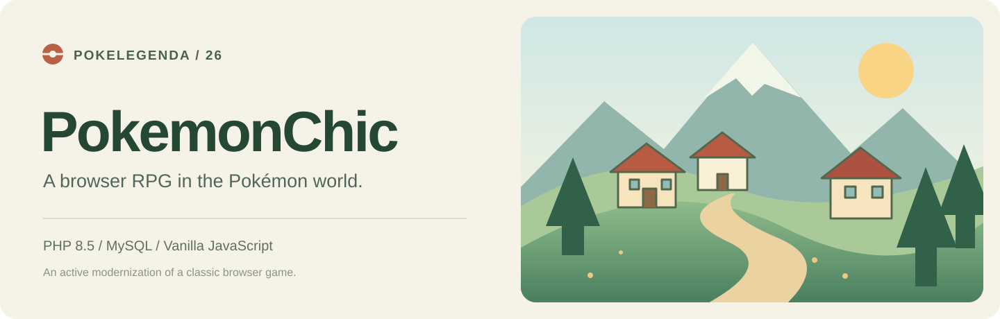
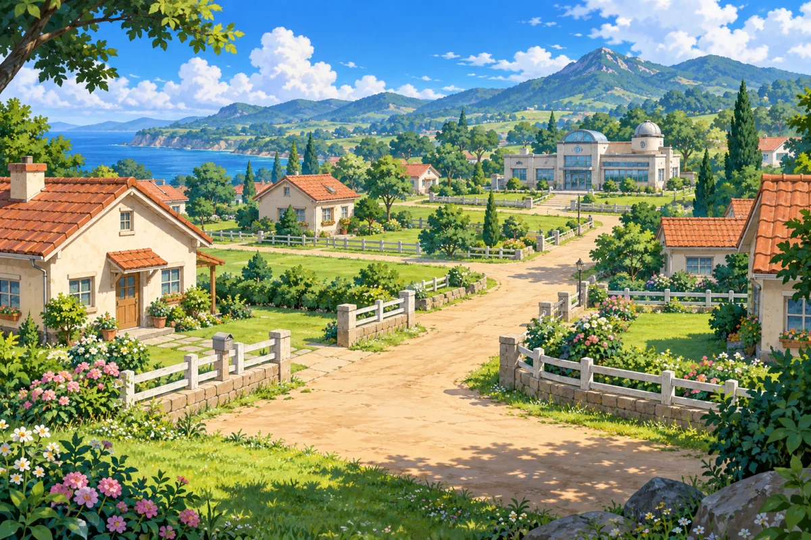
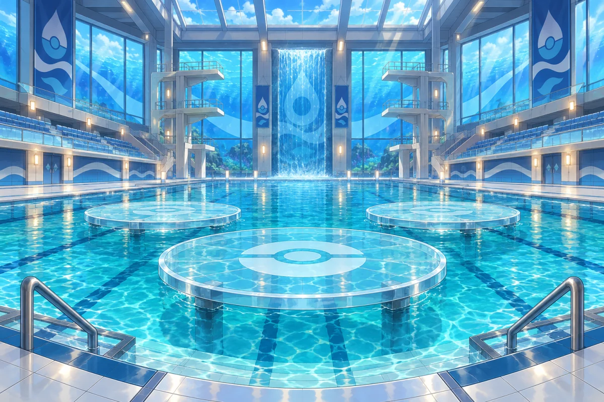

<!-- Repository cover is local and renders without third-party image services. -->
<p align="center"></p>

<p align="center">
  <a href="https://github.com/Mewt0/pokelegenda26/actions/workflows/ci.yml"></a>
  
  
  
  
</p>

<p align="center">
  <a href="README_RU.md">Русский</a> ·
  <a href="docs/GETTING_STARTED.md">Local setup</a> ·
  <a href="docs/TESTING.md">Testing</a> ·
  <a href="#under-the-hood">Architecture</a> ·
  <a href="https://github.com/Mewt0/pokelegenda26/issues">Issues</a>
</p>

PokemonChic is a browser RPG with Pokémon teams, PvE and PvP battles, quests, trading and a connected world. This repository contains the PHP/MySQL game and its ongoing migration from legacy pages to a JSON API and a responsive JavaScript interface.

## A look around the world

<table>
  <tr>
    <td width="50%"><br><strong>A place to begin</strong><br>Alabastia and the professor’s laboratory.</td>
    <td width="50%"><br><strong>Beyond the town</strong><br>Forests, caves, coastal routes and regional towns.</td>
  </tr>
  <tr>
    <td><br><strong>Battle arenas</strong><br>Distinct environments for eight gym types.</td>
    <td><br><strong>Travel between regions</strong><br>Ports, ferries and flights connect the world.</td>
  </tr>
</table>

## What you can do

| System | In the game |
| --- | --- |
| Explore | Move between locations, meet NPCs, follow quests and travel by ship or plane. |
| Build a team | Catch Pokémon, manage the team and nursery, hatch eggs and use breeding systems. |
| Battle | Fight wild Pokémon or other trainers, use moves and items, and review battle history. |
| Trade | Use the inventory, shops and commission market for items, Pokémon and eggs. |
| Stay connected | Chat, mail, friends, trainer cards, tournaments and game events. |
| Run the world | A Game Master Center provides content, moderation, grants and QA tools. |

The latest art refresh connects **155 locations** to illustrated backgrounds and adds **42 NPC, route and reference icons**. Shared biomes reuse suitable art. Pokémon sprites and inventory artwork stay unchanged.

## Under the hood

```text
Browser /game
    │
    ├── PHP views + vanilla JavaScript / CSS
    │
    └── JSON API → Controllers → Game services → Repositories → MySQL
```

| Path | Purpose |
| --- | --- |
| `public/index.php` | API and game front controller |
| `src/Controller/` | HTTP endpoints |
| `src/Game/`, `src/Service/` | Battles, NPCs, rewards and gameplay services |
| `src/Repository/` | Database access |
| `views/`, `public/js/`, `public/css/` | Game interface |
| `database/migrations/` | Incremental schema and content migrations |
| `tools/` | Backup, migration, audit and regression commands |
| `img/`, `pok/`, `public/img/` | World, Pokémon and interface assets |

The root landing page and some compatibility paths still use legacy files. Keep `include/`, `admin/` and root PHP files until their runtime dependencies have been retired.

## Work on the project

Use **PHP 8.5**, Apache with `mod_rewrite`, and a MySQL-compatible database. The current local installation uses MySQL 5.5. PDO MySQL and mbstring are required; QA and art tooling also use curl, GD and zip.

```bash
git clone https://github.com/Mewt0/pokelegenda26.git
cd pokelegenda26
cp .env.example .env
```

Configure a private `.env` and an authorized game database, then follow [local setup](docs/GETTING_STARTED.md). Migrations extend the existing game schema; the repository does not distribute player databases or credentials.

For checks that need no database:

```bash
php tools/ci_lint.php
php tools/encoding_guard.php
php tools/pdo_param_audit.php --self-test
```

Database-backed suites, backups and QA accounts are covered in [Testing](docs/TESTING.md).

## Current scope

This is an active development snapshot. Source checks in GitHub Actions validate syntax and selected static safeguards. They do not certify a production deployment, all quest stories, economy balance or long PvP sessions.

See [the architecture overview](#under-the-hood), [local setup](docs/GETTING_STARTED.md) and [testing instructions](docs/TESTING.md) to work on the game.

## Contributing

Open an issue with the page or location, steps to reproduce, expected behavior and a screenshot when useful. Include the checks you ran in a pull request. [Development notes](docs/GETTING_STARTED.md#development) describe the code and data boundaries.

Third-party artwork, characters and bundled components retain their respective rights and licenses.
